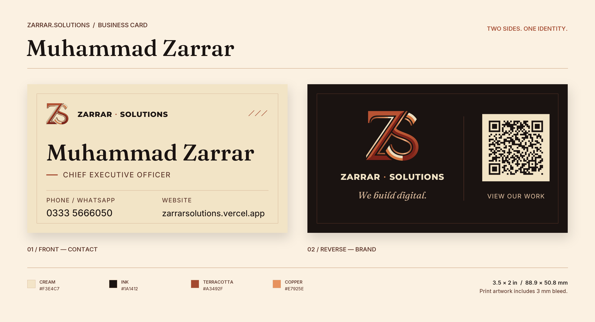

# Muhammad Zarrar — business card

A two-sided card for **Muhammad Zarrar, CEO of Zarrar.Solutions**. The cream
contact side uses the website's editorial typography and gallery frame; the
dark-ink reverse pairs the real ZS monogram with a website QR.



## Deliverables

- **[Clean front/back PDF](exports/zarrar-business-card-clean.pdf)** — just the
  cards: cream front on a dark-ink background, then dark-ink reverse on cream.
  No headings, captions, swatches, shadows, or crop marks. Card artwork stays
  at actual size, centered with a 12.7 mm surround; pages are 114.3 × 76.2 mm.
  This is for presentation/sharing; use the print PDF for production.
- [Print PDF](exports/zarrar-business-card-print.pdf) — two pages, 3 mm bleed,
  crop marks, explicit TrimBox/BleedBox, embedded fonts.
- [Digital PDF](exports/zarrar-business-card-digital.pdf) — finished-size pages,
  clickable telephone and website links.
- [Complete print pack](exports/zarrar-business-card-print-pack.zip) — all three
  PDFs, self-contained SVGs, 300 dpi PNGs, preview, preflight report and notes.
- [Front SVG](exports/front.svg) / [reverse SVG](exports/back.svg) — type and
  QR as vector paths, original logo embedded. Includes bleed, no crop marks.
- [Print instructions](PRINT-README.txt) and [preflight results](exports/preflight.json).

**Finished size:** 88.9 × 50.8 mm / 3.5 × 2 in. Landscape, 3 mm bleed, 5 mm
content safety. Page 1 is the contact side; page 2 is the brand reverse.

## Regenerate with Python

Python 3.11+; the website's Node dependencies are not needed.

```bash
# From the repository root:
python3 -m venv .venv
.venv/bin/python -m pip install -r design/business-card/requirements.txt
.venv/bin/python scripts/generate_business_card.py
```

Edit [`card.json`](card.json) to change the copy. On Windows, use
`.venv\Scripts\python.exe` instead. Once the packages are installed, generation
runs entirely offline. The script resolves all website assets relative to its
own location, so it can also be invoked from another working directory.

```bash
.venv/bin/python scripts/generate_business_card.py \
  --config design/business-card/card.json \
  --output-dir design/business-card/exports

# Regression tests against the generated artifacts:
.venv/bin/python -m unittest discover -s scripts -p 'test_business_card.py'
```

This is a deliberately typeset design, not an auto-fitting template: longer
copy or a different card size may need layout edits. Generation rejects
out-of-safe-zone content instead of silently shrinking it or clipping it.

## Actual brand assets, not a reinterpretation

- Colors are read directly from `src/app/globals.css`, rather than older
  palette files or README descriptions: cream `#F3E4C7`, dark ink `#1A1412`,
  terracotta `#A3492F`, copper `#E7925E`, walnut `#5A3328`, sand `#D8B89A`.
- The logo is `public/images/logo-mark-transparent-original.png`, the same
  pixel original used by `scripts/generate-assets.mjs` for OG images.
  Only its transparent outer margin is cropped. No redraw, resampling, or
  AI alteration. It stays above 300 effective ppi at both placements.
- Fraunces 520 / italic 420, Inter 450 / 550, Montserrat ExtraBold are
  instantiated from the site's self-hosted WOFF2 fonts. The generated static
  TTFs live in a temporary directory and are never committed or distributed.
- PDF typography is embedded, selectable text. SVG typography is outlined
  so another computer cannot silently substitute a different font. The SVGs
  have an embedded raster logo; they are not represented as entirely vector.
- The website's existing “We build digital” tagline is reused. No email,
  invented address, additional URL, or unrequested contact details are added.
- `Zarrar.Solutions` is the **brand**, not a second website. Both the printed
  URL and QR use the supplied `https://zarrarsolutions.vercel.app` address.

## Checks and print caveats

Every run checks two-page PDF structure, trim/bleed/media dimensions,
embedded fonts, extracted contact text, digital links, actual glyph safety,
logo resolution and text contrast. It decodes the QR from **all three exported
PDFs**, at 150 and 300 dpi, and writes `exports/preflight.json`. The preview
and PNGs are rendered from the actual finished-size PDF, not a parallel mockup.
The clean PDF reuses the same vector card drawings, clipped to their finished
edges, with only the opposite brand color outside each card.

The print PDF is **RGB artwork with K-only crop marks**, not a certified
CMYK/PDF-X file. This preserves the requested website colors without inventing
an unspecified press profile. Ask the printer to convert for their press and
stock and approve a physical color/trim/QR proof. See `PRINT-README.txt`.

Suggested stock: 350 gsm smooth matte. The PNG presentation's drop shadows
are not printed on the cards. Do not use the presentation image as print art.

All website source and assets are left unchanged. Only the independent card
tooling, its dependencies, documentation, and requested deliverables are added.
